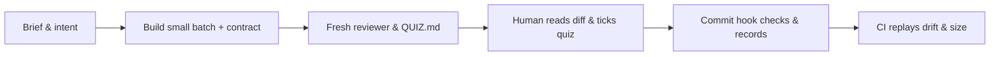

# SDD-Fabrik

Coding agents write code faster than a team can read it. Most agent harnesses help them write even more: longer
prompts, more autonomy, bigger changes. SDD-Fabrik does the opposite: agent code enters the repository only as fast as
a human understands it.

It is a small git harness. Intent lives in short markdown contracts next to the code, agents work in small
single-module batches, and an agent code batch enters history only once the human has answered a short quiz that
makes them predict what the new code does.

Works with any coding agent that reads `AGENTS.md` (Claude Code, Codex, opencode, Cursor, Copilot, Aider), on Linux,
macOS and Windows. Needs only `git` (on Windows, Git for Windows, which brings `bash`, `sed` and `awk`). Python 3 is
optional: it adds opencode's logs to the team ledger and unlocks local hints and Claude Code's cost report.

To install, tell your agent: `Deploy https://github.com/GrIc/sdd-fabrik in this repo` (see
[Deploy (for agents)](#deploy-for-agents)).

## How it differs

| | Common agent setups | SDD-Fabrik |
|---|---|---|
| What sets the pace | What the agent can generate. | What a human understands: an agent batch commits once the human answers its quiz right. |
| Where the rules live | Long prompts, protocols and personas the agent must remember, and drops as context grows. | About 200 lines of rules, backed by a git hook and a CI step the agent meets without remembering them. |
| What a spec is | A long document written before the code, which drifts once the code moves. | A contract of at most 50 lines per module, linked to its tests: an agent commit whose code moves without it is refused. |
| Size of a change | As large as the agent makes it. | 200 changed lines of code and tests in one module, unless a human writes why. |
| What is measured | People: velocity or tokens per developer. | The product: tokens and quiz results per module and month, with no name. |
| What it takes | A wrapper, an SDK, a service, or one vendor's agent. | git and bash, inside your repo, with any agent that reads `AGENTS.md`. |

Why it matters: human understanding is now the scarce part, knowing what the code does, why, and answering for it when
production breaks. A team that merges faster than it understands builds comprehension debt until the first incident.

## A deliberate stance

- Pace follows comprehension, never generation: a team only owns what it can read and explain.
- Intent is the asset; code is its consequence: implementation facts (SQL shapes, file layouts, JSON schemas) belong in
  code and tests, never in a contract.
- Incentives, never locks. Every check can be bypassed on purpose: `Spec-Unchanged` and `Large-Batch` leave a
  visible reason in the commit message, and `--no-verify` skips the local hook (while CI still replays drift and size on
  push). Agent commits are blocked on drift, size or a failed quiz; on a human's own commits, drift and size only warn,
  and only structural errors (an empty `governs`, or a trailer naming a missing module) stop everyone. Even at high
  risk, a second human's reading is recommended, never enforced, so a solo developer can use the entire harness.
- Measure the product, never the people. Token spend and quiz outcomes are summed by module and month in anonymous
  git notes (`refs/notes/sdd-ledger`), under random keys dated the first of the month: no commit, no author, no day.
  Names appear only to coordinate action right now (whose branch waits for review, or whom to ask on an unfamiliar
  module), never to score individuals.
- Adapt to humans and learn from them, locally. Seniority is never guessed and quizzes never grade people: a
  developer's first visit to a module is spotted from local `git log` alone, and recurring *unclear* or *not what I
  wanted* flags in the local quiz journal turn into proposed rules, applied only on a human *yes*.
- Owned by the repository, tied to no vendor. Plain Markdown, about 800 lines of bash 3.2 across three scripts, and
  one optional, read-only Python 3 file (`cockpit.py`, stdlib only) inside your repo. MIT licensed, deployable from an
  internal git mirror, and removable without losing the project's own knowledge.

## What it does, and what it does not

### What it does

| Capability | How it works |
|---|---|
| Module contracts & drift check | Each `sdd/modules/<module>.md` (`<= 50` lines) declares `governs` pathspecs, optional `depends` and `risk: high`, and plain-sentence criteria linked to real tests (or checked by hand when unlinked). Touching governed code without updating its contract, or stating `Spec-Unchanged(<module>): <reason>`, refuses an agent commit; links to missing files or renamed tests fail as drift too. |
| Small, single-module batches | Refuses agent commits above 200 changed lines of code and tests (with a 5% note margin so agents never trim tests or names to fit) or spanning a second unspared module, unless the human writes `Large-Batch: <reason>` (`Spec-Unchanged` spares its module from the one-module limit, not the line count). |
| Fresh review & risk-scaled quiz | A fresh agent context reviews the staged diff against the contract and coding style, then writes `QUIZ.md` and a hidden key in `.git/sdd/`: 3 predictive questions by default, 5 when `risk: high` (recommending a second human's reading), 0 for Markdown-only changes outside `sdd/modules/`. Passing stamps `Quiz: 3/3` (or `5/5`) on the commit. |
| Quiz feedback loop | Every graded try is logged locally in `quiz-journal`. A wrong answer writes a directional hint and optional checkboxes (*not understood*, *unclear*, *not what I wanted*) into `QUIZ.md`; typing `quiz feedback` has the agent walk through the gap, and it spends nothing until the developer asks. |
| Pace & module onboarding (`sdd brief`) | Before a batch, surfaces unanswered `QUIZ.md` files in sibling worktrees and remote branches waiting for review past `REVIEW_WAIT_HOURS` (4h by default), and spots a developer's first batch in a module to offer discovery mode and name the three teammates who delivered there most. |
| Anonymous team ledger | Hooks record token spend (writer vs. reviewer, by model) and passed quizzes (tries, flags and the developer's own words, never a name) per module and month in `refs/notes/sdd-ledger` and sync them on push (`git config sdd.ledger false` opts out). `ledger report` maps feature cost, first-try comprehension, unclear/intent flags, and bus factor (distinct quiz passers per module, as a count without names). |
| Private cockpit & self-tuning | On the developer's machine over their last 10 agent batches (with Python 3), `cockpit report` breaks down Claude Code tokens (roles, models, context startup, cache reads, MCP servers, plugins, tool output). At most once in 10 batches, `cockpit hints` flags avoidable Claude Code overhead or any module whose quizzes were flagged *unclear* or *not what I wanted* twice, so the agent can propose a trim or a new rule. |
| Quiet runner (`sdd quiet`) | Runs verbose test or build commands and prints one line when green, or the last 30 lines when red, keeping agent context lean. |

### What it deliberately does not do

- Run, generate, or judge your tests. It does not execute test suites, enforce coverage targets, run mutation
  testing, write BDD/Gherkin scenarios, or synthesize test data. Your CI runs tests; SDD-Fabrik checks that contract
  criteria link to existing tests and move with the code.
- Replace product framing or team ceremonies. No sprints, roles, user-story templates, or backlog management.
  Upstream discovery and framing methods (RFCs, Shape Up, BMAD) stop where SDD-Fabrik starts: at the repository and the
  commit.
- Wrap or orchestrate agents. No custom CLI wrapper, daemon, SDK, database, or API proxy, and no LLM call at commit
  time: the git hook grades `QUIZ.md` offline.
- Manage your git forge. No pull-request automation, reviewer assignment, merge queue, or preview environments. A
  GitHub Actions workflow is included to replay drift and size in CI; any other forge runs the same
  `bash sdd/bin/sdd audit --range <base>..<tip>` command on a full-history checkout.
- Sandbox agents or filter sensitive data. `AGENTS.md` sets house rules and deployment configures tool deny lists
  where supported, but preventing access to secrets or real data belongs to your environment.
- Monitor or rank developers. No per-person token chart, velocity metric, or quiz score.
- Read every agent's cost logs yet. Any agent that reads `AGENTS.md` gets the workflow, checks, quiz, and
  quiz-flag hints (with Python 3); token accounting reads Claude Code (in awk) and opencode (with Python 3), and
  `cockpit report` / cost hints read Claude Code.

## Getting started and daily use

### 1. What lives in your repository

Kit-owned files (`sdd/bin/`, `sdd/WORKFLOW.md`, `sdd/guide/`, and the marked block in `AGENTS.md`) are replaced cleanly
on upgrade. Everything else belongs to your project:

```
AGENTS.md, CLAUDE.md       agent instructions + the SDD-Fabrik block (@AGENTS.md import for Claude Code)
.gitattributes             keeps sdd/bin/* LF on Windows checkouts
.github/workflows/sdd.yml  replays drift and size on pushed commits
sdd/
  README.md                your system map and module table (first line tracks source URL and tag)
  coding-style.md          your settled code, test and command conventions
  WORKFLOW.md, guide/      kit-owned batch loop and on-demand guides (start, plan, tokens, upgrade)
  bin/{sdd,ledger,cockpit,cockpit.py}
                           kit-owned scripts
  modules/<module>.md      created as needed: short contracts (<= 50 lines)
  {product,design,architecture,decisions,roadmap}.md
                           created as needed: flat topic files (decisions carry Rejected: lines)
  changes/<slug>.md        created for multi-batch work, shrunk per batch and deleted when done
  issues/<slug>.md         created on the fly (INTAKE) for passing bugs/ideas, deleted when delivered
```

### 2. First batch: `GENESIS` or `ADOPT`

Once you commit the deployment, the agent continues directly into your first batch from `sdd/guide/start.md`:

- New project (`GENESIS`): the agent asks one question at a time (first useful slice, audience, non-goals, coding
  conventions, quality bar), scaffolds only what that first slice needs, strips unused generator output, and writes the
  first contracts.
- Existing codebase (`ADOPT`): the agent reads your existing docs, tests and entry points without changing behavior,
  writes `sdd/coding-style.md` from what the codebase already does, and adds contracts only where intent is not obvious
  from code and tests. Improvements spotted along the way become `sdd/issues/` stubs, not silent rewrites.

### 3. How a batch flows



1. Plan (when work spans several batches). The agent writes `sdd/changes/<slug>.md` with one section per
   single-module batch and adds a link in `sdd/roadmap.md`; a fresh reviewer checks it and you validate it.
2. Brief & build. The agent runs `sdd brief <module>`, asks open intent questions up front, builds the smallest
   coherent change with its tests, updates the module contract (or proposes `Spec-Unchanged(<module>): <reason>`),
   stages the batch, writes `.git/sdd/message` with `Agent-Assisted: yes`, and runs
   `bash sdd/bin/sdd audit --message .git/sdd/message`.
3. Fresh review & quiz. A fresh agent context (on a smaller model unless the batch is large or touches security or
   data) checks the staged diff against the contract and coding style, reads past unclear questions via
   `ledger quiz <module>`, writes `QUIZ.md` and its hidden key, and re-runs `sdd audit --message .git/sdd/message`.
4. Human check & commit. You read the diff and the agent's handoff (purpose, fact decisions taken alone, evidence,
   limits), tick your answers in `QUIZ.md` (kept out of git), and commit from your terminal or IDE
   (`git commit -F .git/sdd/message`). The agent never commits, pushes, or ticks `QUIZ.md`.
   - If an answer is wrong, read the hint written inside `QUIZ.md`. When the code does not match what you meant, tick
     *The code does not do what I wanted* and type `quiz feedback` to your agent.
5. Fresh session & hints. Start the next batch in a new session so the agent does not re-read a long history on
   every call. At handoff, `cockpit hints` prints nothing unless your last 10 batches show something new to cut or a
   module flagged twice in quizzes.
6. Push & merge. Pushing syncs anonymous `sdd-ledger` notes, and CI replays drift and size on each commit. Merge
   branches with a merge commit or a rebase (squash merges add batches up and drop per-commit trailers). To amend a
   committed agent batch that changes files, run `git reset --soft HEAD^` and commit again.

### 4. Useful commands

| Command | Purpose |
|---|---|
| `bash sdd/bin/sdd audit [--message <file>]` | Check staged changes (drift, contract links, size, `QUIZ.md` form if present, markdown-to-code ratio). |
| `bash sdd/bin/sdd brief [<module>]` | Show pending quizzes, branches awaiting review, or whether a module is new to you. |
| `bash sdd/bin/cockpit report "$PWD"` | Inspect your local Claude Code token breakdown: roles, models, cache, MCP, plugins, tool output (Python 3). |
| `bash sdd/bin/ledger report` | View the team's anonymous feature costs, quiz comprehension map and module bus factor. |
| `git config sdd.ledger false` | Stop recording ledger notes in this clone (`--global` for every repository). |

## Deploy (for agents)

You were asked to deploy SDD-Fabrik in the current repository. Do this:

1. Check the dependencies: `git`, `bash`, `sed` and `awk`. If any is missing, tell the human which ones and how to
   install them for their system, and stop.
2. Fetch the latest release into a temporary directory, taking the highest `vX.Y.Z` from the first command. `<source>`
   is the URL the human gave, such as an internal mirror, or else `https://github.com/GrIc/sdd-fabrik`:

   ```
   git ls-remote --tags --refs <source>
   git clone --depth 1 --branch <tag> <source> <tmp>
   ```
3. Copy `<tmp>/template/` into the repository root without overwriting anything. Where a file already exists:
   - `AGENTS.md`: append the block between `<!-- sdd-fabrik -->` and `<!-- /sdd-fabrik -->`;
   - `CLAUDE.md`: add a line `@AGENTS.md`;
   - `.gitattributes`: append its line, which keeps the scripts' line ends LF on Windows;
   - a CI workflow: add its step and `fetch-depth: 0` from `.github/workflows/sdd.yml` to it, or keep both;
   - anything else: stop and ask the human.
4. Replace `<source>` and `<tag>` on the first line of `sdd/README.md` with the URL and the tag you deployed from.
5. Run `bash sdd/bin/sdd install-hook`. If it declines because another hook is in place, show the human the lines it
   printed.
6. If your tool has a permission deny list, add `git commit`, `git push` and `--no-verify` to it. If it commits on its
   own (Aider does by default, without hooks), turn that off. Tell the human that for their other agents these rules
   are instructions only.
7. Delete `<tmp>`. Report the files added and merged, the dependencies, and a proposed commit message with
   `Large-Batch: deploys SDD-Fabrik` (the script alone is over the size limit) and without `Agent-Assisted` or an
   agent's `Co-Authored-By` (the files come from the kit, not from you). The human commits.
8. Then follow GENESIS (no code yet) or ADOPT (existing code) in `sdd/guide/start.md`, as your first batch.

To upgrade or uninstall, follow `sdd/guide/upgrade.md` in the deployed repository.

## Design decisions

The decisions behind this harness, with field evidence from real pilots and the `Rejected:` alternatives, are recorded
in [docs/decisions.md](docs/decisions.md).

## Develop the kit

Edit `template/`, never duplicate it elsewhere; the kit runs its own harness. Run `bash test/run`, `bash test/ledger`
and `bash test/cockpit` before proposing a batch. See [AGENTS.md](AGENTS.md).

MIT licensed, see [LICENSE](LICENSE).
